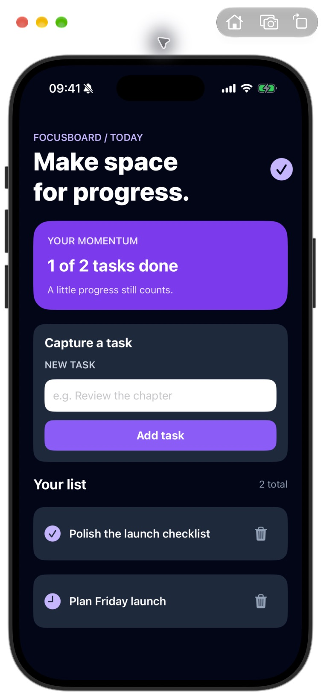

# Focusboard

A small offline to-do app built with Laravel 13 and SuperNative in NativePHP Mobile 4. The screen is authored with a `NativeComponent` and native Blade elements; tasks persist in the device's SQLite database.



## Run it

Requirements: PHP 8.3+, Composer, Xcode and an iOS simulator. Clone the repository, then run:

```bash
composer install
cp .env.example .env
php artisan key:generate
php artisan native:install ios
php artisan native:run ios
```

Set `NATIVEPHP_APP_ID` in `.env` to a bundle identifier you own before distributing the app. NativePHP prepares and migrates the app's SQLite database on the simulator or device.

## Where the app lives

- `routes/web.php` registers the native root route.
- `app/NativeComponents/Tasks.php` holds typed state and add, toggle and remove actions.
- `resources/views/native/tasks.blade.php` renders the native UI.
- `app/Models/Task.php` and the task migration persist the list locally.
- `tests/Feature/TasksScreenTest.php` checks the add and completion flow.

The app uses the official `nativephp/mobile-ui` package for native text, input and icon rendering. It has no additional device feature plugins. Run `php artisan test` for the PHP interaction tests. The screenshot was captured after an iOS simulator build and manual add, complete and remove checks.
